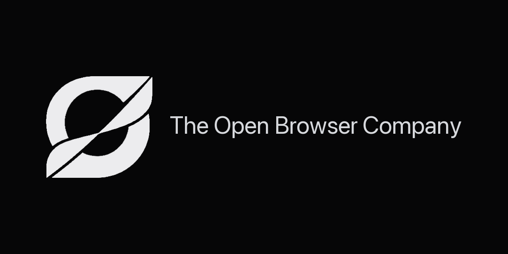
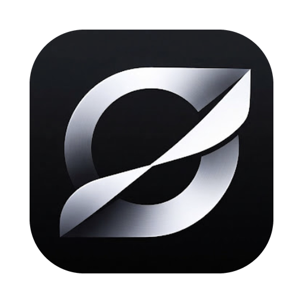
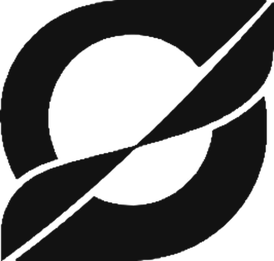

<div align="center">
  
</div>

<h1 align="center">Solstice</h1>

<p align="center">
  A Web with freedom.<br>
  Arc's sidebar and Dia's polish on real Chromium.<br>
  Free and open source. Ads and trackers stay out.
</p>

<p align="center">
  <em>An independent software company building open-source browsers and tools for a better web.</em>
</p>

<p align="center">
  <a href="#download">Download</a> · <a href="#what-solstice-is">What it is</a> · <a href="#built-in-the-open">Built in the open</a> · <a href="#build-from-source">Build from source</a>
</p>

<p align="center">
  
</p>

## Download

<p align="center">
  
</p>

| Platform | Get Solstice |
| --- | --- |
| **macOS** — 14 Sonoma or later, Apple Silicon | [Solstice 0.2.48 (DMG)](https://github.com/ardia-browser/ardia/releases/download/v0.2.48/Solstice-0.2.48.dmg) · 134 MB · notarized by Apple · one drag into Applications. Or `brew install ardia-browser/tap/ardia`. |
| **macOS nightly** | [ardia.dev/nightly](https://ardia.dev/nightly) — every fix the day it's made, smudges and all. |
| **Linux** — x86-64, Wayland or X11 | [Installing on Linux](docs/linux-port.md#installing-on-linux) — `.deb`, AppImage, tarball and Arch source package; stables as `ardia-bin` on the AUR. |
| **iPhone** | [TestFlight](https://testflight.apple.com/join/yXHasDmr) |
| **Android** | [Solstice 1.0.2 (APK)](https://github.com/ardia-browser/ardia/releases/download/android-v1.0.2/Solstice-1.0.2.apk) |

<p align="center">
  <a href="https://ardia.dev">ardia.dev</a> · <a href="https://ardia.dev/release-notes">What's new</a> · <a href="https://github.com/ardia-browser/ardia/releases">All releases</a> · <a href="https://discord.gg/TdhuXrbcA6">Discord</a>
</p>

<p align="center">
  On another platform? <a href="https://github.com/ardia-browser/ardia/releases">Watch the releases</a> and GitHub will tell you when your build ships.
</p>

## What Solstice is

Solstice is a browser built by The Open Browser Company. It moves the address bar into the sidebar so the page runs to the top of the window, turns tabs into draggable panes, keeps video playing when you switch away, and brings Chrome Web Store extensions and Sync along. Ads and trackers stay out: the full uBlock Origin is built in (cookie banners included), Google's background services are compiled out, and crash reports are opt-in and never carry your sites or searches.

### Lose the toolbar

Move the address bar into the sidebar and the page runs all the way to the top of the window.


### Two pages, one window

Drag a tab onto the page. Up to three panes, side by side or stacked.


### Refuses to leave the picture

Switch tabs mid-video and it floats along in the corner. Go back to its tab and it slips back into the page.


### Also inside

- **Your extensions come along.** The Chrome Web Store just works, its button says Add to Solstice, and Sync takes them to your other Macs.
- **Work stays at work.** Each profile keeps its own logins, history, extensions and colour. Swipe the sidebar to switch.
- **Little Solstice.** ⌥⌘N opens a small window with one page and no sidebar.
- **Groups on contact.** Drop a tab on a tab and they're a group, named for you.
- **Moves in for you.** Bookmarks, history, passwords and logins from Chrome, Safari, Firefox, Arc, Dia and five more. Arc's spaces, pinned tabs and themes too.
- **Paints like Arc.** Gradient themes per profile: up to three colours, some grain, some blur.
- **Syncs through your iCloud.** End-to-end encrypted, in a folder in your own iCloud Drive. No server of ours in the middle.
- **Command bar.** ⌘L finds tabs, history and bookmarks, does your sums, and knows doc.new and 16 friends.
- **Tidies up.** ⌥⌘K sweeps the tabs you haven't touched into Recently Cleaned.
- **Clean links.** Copy a link and the tracking junk stays behind.
- **Naps when you do.** Background tabs past your latest five freeze, and sleep after half an hour.
- **Sits still.** Idles under half a percent of CPU with a tab open.
- **Updates itself.** Quietly, then shows you what changed.

### It's actually Chromium

Not WebKit. Not Electron. Every window is Chrome's own, so sites, extensions and DevTools behave like they do in Chrome.

| Part | Details | Status |
| --- | --- | --- |
| Engine | Chromium 158, on Chrome's own framework. | ✓ Yes |
| De-Googled | Google's background services stripped out. | ✓ Yes |
| H.264 and AAC | The codecs Chromium leaves out. | ✓ Yes |
| DevTools | Docked, with device mode. Like Chrome. | ✓ Yes |
| Sync | End-to-end encrypted, through your own iCloud Drive. | ✓ Yes |
| Translate | On your Mac. Nothing leaves it. | ✓ macOS 26 |
| Passkeys | Touch ID and iCloud Keychain. | ~ Partly |
| Netflix and DRM | Streaming sites open in WebKit, where they play. Widevine in Chromium waits on Google. | ~ Partly |
| Intel Macs | Apple Silicon only. | ✗ No |

<p align="center">
  
</p>

## Built in the open

Solstice is developed in public at **[github.com/ardia-browser/ardia](https://github.com/ardia-browser/ardia)**. Its own source files are under the [Apache License 2.0](LICENSE.Apache-2.0); the browser as distributed is [GPL-3.0](LICENSE) because its engine is built with GPL-3.0 patches. It also builds on Chromium, carries a few of the Chromium Embedded Framework's patches to Chromium (BSD-3-Clause), and bundles uBlock Origin, each under its own license — see [NOTICE](NOTICE). Every release links its source.

Feature parity with Dia (everything but its AI) is tracked row by row in [docs/dia-feature-parity.md](docs/dia-feature-parity.md); releases and their notes are at [ardia.dev/release-notes](https://ardia.dev/release-notes).

## The repository

A macOS browser that looks and feels like [Dia](https://diabrowser.com): Chrome's own framework from our patched Chromium with our layer on top (ArdiaCore), an Expo + React Native macOS shell, and Metal shaders reconstructed from Dia's own New Tab effects.

```
apps/
  browser/     Expo + react-native-macos app (UI in src/, Xcode project in macos/)
  desktop/     Shared browser UI built for Linux, and the coming Windows WebUI host
  linux/       Linux desktop entry, window controls and native host integration
packages/
  ardiacore/   The engine: Chromium 158's framework with our layer, JS API in src/
  shell/       Native menu bar + shortcuts → JS, windows, SF Symbols, native primitives
  shaders/     Metal: New Tab effects + grained OKLab window backdrop
  import/      Import from other browsers (bookmarks, history, passwords, Arc spaces)
  core/        Pure TS: omnibox input → URL, suggestions, Dia-style breadcrumbs
```

## Build from source

The macOS app requires Xcode 26+, CocoaPods, Node 24 (pinned in `.nvmrc`) and pnpm 12.

```bash
pnpm install
pnpm pods
```

Start Metro with `pnpm dev` in one terminal, then build and launch the Debug app with `pnpm macos` in another (on its own data, `~/Library/Application Support/Solstice Dev`, or `ARDIA_DATA_DIR`).

The engine (Chrome's framework, built from our patched Chromium) comes prebuilt: with no local engine build, the app downloads the one matching your checkout's macOS engine key (`engine/engine-key.sh --platform macos`; about 110 MB, once, Apple Silicon only) and checks it against `packages/ardiacore/prebuilt-engines.tsv`. Every release whose engine changed publishes one. If `main`'s engine is newer than the last release's, work from a release tag (`v0.2.30`, say), or run `packages/ardiacore/scripts/fetch-engine.sh --nearest` to build against the newest prebuilt anyway. Passkeys and saved cards need our team ID and won't work in a build signed by anyone else.

Other tasks: `pnpm typecheck`, `pnpm test`, `pnpm shaders:check` (compiles the embedded Metal offline), and `scripts/agent/build-app --config Release` (a Release `.app` with a Hermes bytecode bundle; `--help`). Signed releases (DMG, Sparkle zip and appcast) are built by the Release workflow with `scripts/release.sh`; see [docs/releasing.md](docs/releasing.md).

For Linux packaging and the source build, see [docs/linux-port.md › Installing on Linux](docs/linux-port.md#installing-on-linux). To change the engine itself, rebuild from our patched Chromium tree — see [docs/engine-build.md](docs/engine-build.md) (`autoninja -C out/Release_GN_arm64 chrome_framework`; the first build takes about two hours).

Shortcuts: ⌘T new tab, ⌘L command bar, ⌘W close, ⇧⌘T reopen, ⌘S sidebar, ⌘[ / ⌘] back/forward, ⌘R reload, ⌘1–⌘9 select tab, ⌃Tab cycle.

<details>
<summary>How Dia's New Tab light works</summary>

Dia 1.50 turns this light off along with its rebrand (a painted mark, a single-colour power-up band and a halo around the bar; `docs/dia-spec.md` › "1.50 Sunglow"), and so does Solstice. The reconstruction left the tree with it: `git show f2c0e251:packages/shaders/ios/AreaLightView.swift`.

These findings come from disassembling the Metal libraries in `Dia.app` (v1.49.1) with `xcrun metal-objdump`. `BoostBrowser_PowerUp.bundle/default.metallib` contains `breathingAreaLightFragment`, which the Swift class `NewTabPage.NewTabAreaLightView` hosts. The reconstruction was `AreaLightView.swift` (above).

- **The command bar is a light source.** Dia models the bar as a rounded-rectangle area light floating `lift` points above the page. Each pixel receives the closed-form irradiance of that rectangle: the solid-angle formula, one `atan` term per corner, times 1/2π. Rounded corners subtract (1 − π/4) of each corner square. The result is a physically correct penumbra: a higher lift gives a softer, wider glow.
- **Falloff** is reshaped from inverse-square to `(h/d)^falloff`, where `d` is the distance to the emitter's rounded-rect surface rather than to its centre.
- **Colour** is Dia's brand spectrum (`ProgressBarColor2…7` in its asset catalog): blue `#0358F7`, steel `#5092C7`, lavender `#E1E1FE`, yellow `#FFD400`, orange `#FA3D1D` and magenta `#FD02F5`. It is laid out as a wrapping, slightly diagonal gradient that scrolls every 20 s. IQ's 2D simplex noise warps the gradient under the bar, and the warp fades out into the penumbra.
- **Dark mode** treats the light as HDR emission and applies the Hable/Uncharted-2 filmic tonemap (white point 11.2), with alpha set to Rec.709 luminance. **Light mode** keeps the flat palette colour and uses the irradiance as opacity.
- **Finishing:** alpha fades over the top 50 pt and bottom 200 pt of the view, and ±3/255 triangular dither (Dave Hoskins' `hash12`) prevents banding in the long soft falloff.
- **Animation:** the shader itself only scrolls the colours. The lift-off intro and the slow "breathing" come from the CPU, which animates `lift` and `intensity`. Those curves live in Dia's Swift code, so the ones here (quartic ease-out over 1.1 s, ±7% intensity on a 5.5 s sine) are my approximation.

The **window backdrop** comes from `ARC_WindowThemeUI.bundle` (`gradientFragment` + `renderFragment`). Gradient stops are stored and mixed in **OKLab**, then converted to linear sRGB and gamma-encoded in the shader. A tiled grain texture is then multiply-blended on top. `WindowBackdropView` does the same with procedural grain.

Only math and colour values are reused. No Dia images, fonts or binaries are copied into this repo.

</details>

<details>
<summary>Architecture notes</summary>

- **Why Expo SDK 54:** `react-native-macos` tops out at 0.81, which pairs with Expo SDK 54 (whose `ExpoAppDelegate` / `ExpoReactNativeFactory` have macOS code paths).
- **Legacy architecture.** react-native-macos 0.81's Fabric support is experimental, so the app runs on the legacy architecture. One consequence: Expo's legacy view-manager adapter instantiates a module's *first* view class for every view it declares, so each native view has its own module.
- **Metro, not `expo start`.** Metro runs through the react-native-macos CLI. `metro.config.js` redirects `react-native` → `react-native-macos` for `platform=macos`, because defining our own `resolveRequest` replaces the redirect the CLI would install.
- **No Reanimated.** It has no macOS build for 0.81; animations use RN's `Animated`.
- **Monorepo paths.** pnpm is set to `nodeLinker: hoisted` because CocoaPods and Metro resolve `react-native-macos` by path. The Podfile rewrites `REACT_NATIVE_PATH` to the hoisted location and raises every pod's deployment target to 14.0, since Xcode 26+ rejects the 11.0 some Expo pods declare.
- **Native subviews** are sized in `setFrameSize`, not `layout()`. RN macOS assigns frames directly and never autoresizes subviews.
- **Shaders** are Metal source embedded in Swift and compiled at runtime (once per class, cached). This keeps the pods free of a metallib build phase.

</details>

<div align="center" style="background-color:#111114;padding:40px 24px;border-radius:12px;">
  
  <p style="color:#ffffff;margin:14px 0 0;">
    Solstice is built in the open by <strong>The Open Browser Company</strong>.<br>
    An independent software company building open-source browsers and tools for a better web.
  </p>
  <p style="margin:18px 0 0;">
    <a href="https://ardia.dev" style="color:#c9d1d9;">ardia.dev</a> ·
    <a href="https://github.com/ardia-browser/ardia" style="color:#c9d1d9;">GitHub</a> ·
    <a href="LICENSE" style="color:#c9d1d9;">License</a>
  </p>
</div>
